<picture>
  <source media="(prefers-color-scheme: dark)" srcset="docs/banner-dark.svg">
  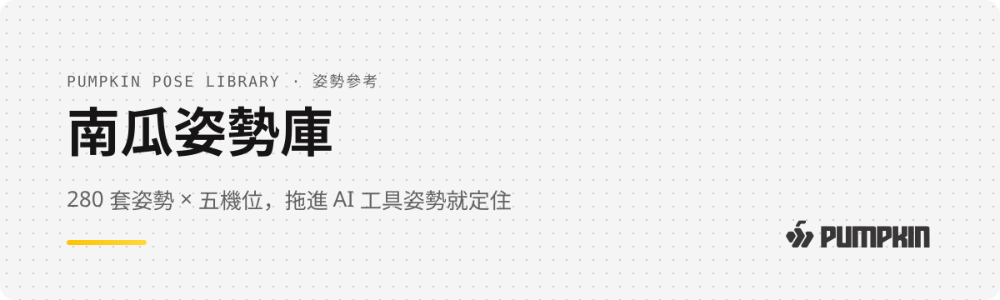
</picture>

<h1 align="center">🧍 南瓜姿勢庫</h1>

<p align="center"><b>280 套無臉素體姿勢 × 五個機位 × 五種格式，再配上 771 件服裝、道具、場景素材，拖進 AI 繪圖工具就定住了</b></p>

<p align="center">
  <a href="https://nanhong-byte.github.io/pumpkin-poses/"></a>
  
  
  
  
</p>

<p align="center">
  <a href="#-五種格式">格式</a> •
  <a href="#-素材庫與搭配盤">素材庫</a> •
  <a href="#-快速開始">快速開始</a> •
  <a href="#-怎麼用">怎麼用</a> •
  <a href="#-搭配-ai-工具">搭配 AI 工具</a> •
  <a href="#-常見問題">常見問題</a>
</p>

**南瓜姿勢庫**是一個免費的姿勢參考網站：280 套沒有臉的素體姿勢，每套最多五個機位，多數機位還附白模、深度圖和法線圖。另外還有六個素材庫：服裝、道具、家具、動物、場景、光線，共 771 件，可以跟姿勢搭成一整組。

用 AI 生圖最難搞的就是姿勢，提示詞寫半天手腳還是亂長；用 3D 軟體擺一個 Pose 又要十幾分鐘。這裡挑一張圖丟進 ComfyUI、Nano Banana 或 ChatGPT，姿勢一次到位。

看完這篇，你會知道每種格式該配哪個工具、怎麼用搭配盤組出一整段提示詞、怎麼一次打包下載整個系列，也能在自己電腦上架一份。

<p align="center">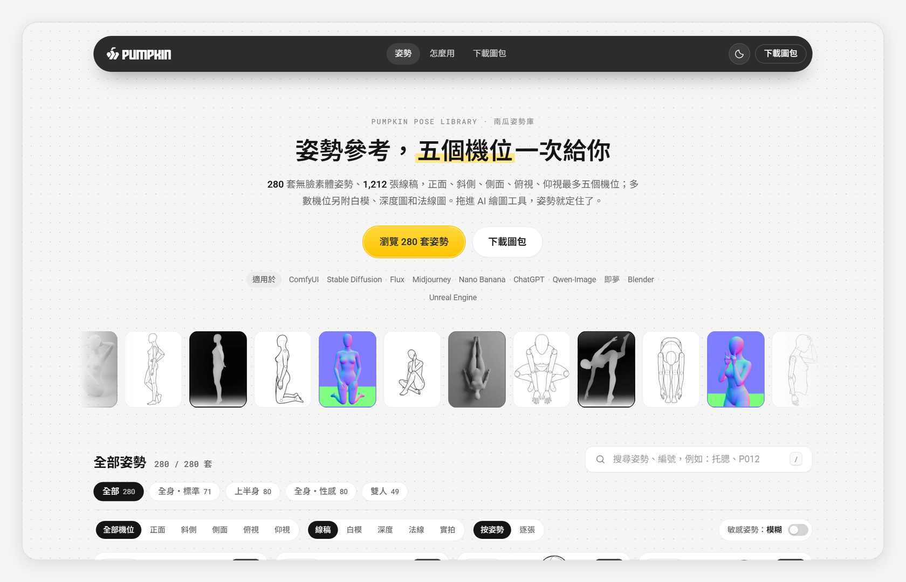</p>

## 📌 目錄

- [✨ 功能一覽](#-功能一覽)
- [🤔 為什麼做這個](#-為什麼做這個)
- [🎨 五種格式](#-五種格式)
- [📐 五個機位](#-五個機位)
- [📚 姿勢分類](#-姿勢分類)
- [🧺 素材庫與搭配盤](#-素材庫與搭配盤)
- [🚀 快速開始](#-快速開始)
- [📖 怎麼用](#-怎麼用)
- [🤖 搭配 AI 工具](#-搭配-ai-工具)
- [🧩 網站怎麼組成](#-網站怎麼組成)
- [📝 名詞對照表](#-名詞對照表)
- [❓ 常見問題](#-常見問題)
- [🧭 接下來](#-接下來)

## ✨ 功能一覽

先看整體能做什麼，細節後面一個一個講。

| | 功能 | 白話說 |
|---|---|---|
| 🧍 | **280 套姿勢、四個系列** | 全身・標準、上半身、全身・性感、雙人，每個系列再細分坐、站、跪、躺等分類 |
| 📐 | **五個機位** | 正面、斜側、側面、俯視、仰視，同一個姿勢換角度看，不用自己腦補 |
| 🖼️ | **五種格式** | 線稿、白模、深度圖、法線圖、實拍風，對應不同的 AI 工具 |
| 🔍 | **搜尋＋篩選** | 打「托腮」「P012」就找得到；機位、格式、顯示方式都能切 |
| 🔎 | **大圖檢視** | 換機位、換格式、五機位一覽、線稿跟白模左右對照 |
| 📋 | **複製 AI 提示詞** | 每套姿勢都附一段英文描述，直接貼進生圖工具 |
| 📦 | **瀏覽器打包下載** | 勾系列、勾格式，按一下就打包成 ZIP，資料夾分好類 |
| 🌙 | **夜間模式＋手機版** | 線稿在夜間自動反白，不刺眼；手機也能順順地滑 |
| 🙈 | **敏感姿勢先模糊** | 性感、雙人類姿勢預設模糊，點一下才顯示，在公司打開不尷尬 |
| 🧺 | **六個素材庫** | 服裝、道具、家具、動物、場景、光線共 771 件，每件都有多個角度 |
| 🪄 | **搭配盤** | 一個姿勢＋各庫各挑一件，自動接成一整段英文提示詞，整組圖還能一起打包 |

## 🤔 為什麼做這個

我們做 XR 內容、3D 角色和 AI 輔助企劃，常常卡在同一件事：**姿勢**。

叫 AI 畫「坐在地上、單膝立起、手撐後面」，十張裡有七張手腳打結。改用 3D 軟體擺 Pose 雖然準，但開軟體、選骨架、一個關節一個關節轉，一套姿勢就要十幾分鐘。

所以我們把常用姿勢整理成一個資料庫，每套都準備好 AI 工具最吃的幾種圖。現在找姿勢的流程變成這樣：

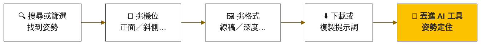

從「想要一個姿勢」到「圖進到 AI 工具裡」，大概 30 秒。

## 🎨 五種格式

同一個姿勢、同一個機位，最多給你五種圖。它們不是重複的，而是各自對應不同工具的「吃法」。

<p align="center">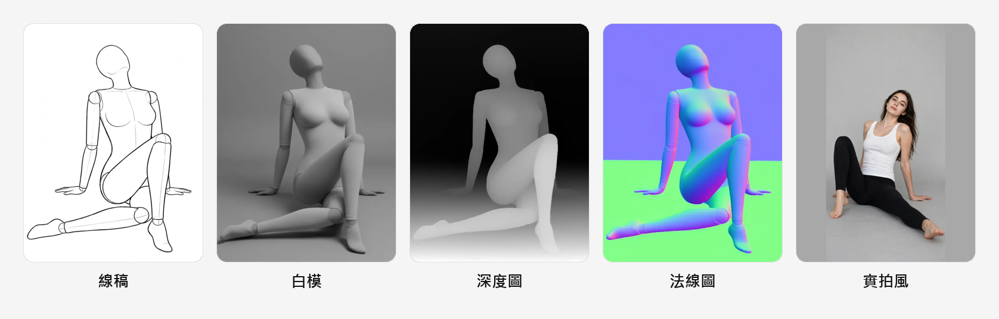</p>

| 格式 | 長什麼樣 | 最適合 | 數量 |
|---|---|---|---:|
| **線稿** | 白底黑線的素體人偶，關節畫成圓圈 | ControlNet Lineart／Canny、直接當參考圖 | 1,212 張 |
| **白模** | 有體積、有明暗的灰色人台 | img2img 底圖、角色設計參考、最不挑工具 | 944 張 |
| **深度圖** | 越近越白、越遠越黑 | ControlNet Depth，前後層次鎖最穩 | 944 張 |
| **法線圖** | 紫藍綠的彩色人形，顏色代表表面朝向 | ControlNet Normal，身體轉向和面的轉折最準 | 944 張 |
| **實拍風** | 寫實照片風格的對照圖 | 看比例、手腳細節、重心 | 89 張 |

線稿、白模、深度圖、法線圖都是 3:4 直式，同一個機位疊起來會完全對齊；實拍風是 1:2 的長直式。每張圖有三種寬度：列表用 300px、縮圖用 600px、大圖和下載用 900px（線稿就是 900 × 1200）。格式是 WebP，檔案小，主流 AI 工具都讀得進去。

> [!TIP]
> 不知道選哪種？**先用線稿**。它最通用，幾乎每個工具都吃；要更穩再換深度圖。

## 📐 五個機位

同一個姿勢，從五個角度拍。畫分鏡、做角色三視圖，或想讓 AI 生出「從上往下看」的構圖時，直接挑對應機位。

<p align="center">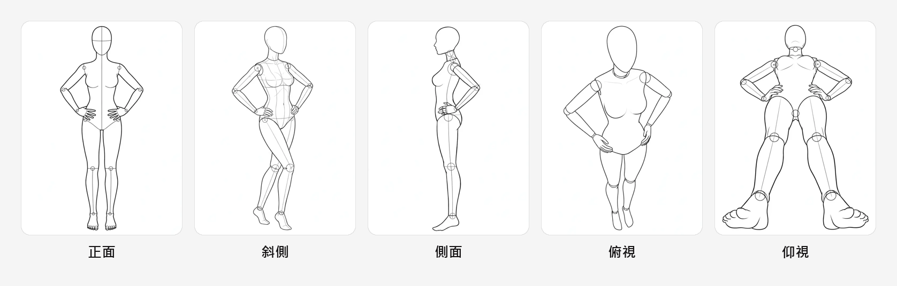</p>

| 機位 | 鏡頭在哪 | 常見用途 |
|---|---|---|
| 正面 | 人物正前方、平視 | 角色設定、立繪 |
| 斜側 | 前方偏 45 度 | 最自然的插畫角度 |
| 側面 | 正側邊 | 看身體輪廓、重心 |
| 俯視 | 從上往下 | 坐姿、躺姿、戲劇張力 |
| 仰視 | 從下往上 | 英雄感、氣勢 |

不是每套姿勢都有齊五個機位。某個角度做出來手腳穿插、比例怪，我們就直接拿掉，寧缺勿濫；卡片上的「正面 1/4」就是在告訴你這套有 4 個機位。

## 📚 姿勢分類

四個系列，每個系列再細分。數字是套數。

| 系列 | 套數 | 分類 |
|---|---:|---|
| **全身・標準** | 71 | 坐姿 14、站立 14、跪姿 9、側坐・鴨子坐 8、躺姿 8、蹲姿 6、前傾 6、後仰 3、扭轉 3 |
| **上半身** | 80 | 性感系 30、可愛系 25、胸線強調系 25 |
| **全身・性感** | 80 | 躺姿 20、站姿 15、坐姿 15、跪姿・爬姿 15、特殊 15 |
| **雙人** | 49 | 面對面躺姿 10、一前一後 7、背對著坐 6、坐在上方 5、站立 4、貼臉系 4、站立貼近 4、側臥 3、坐姿 2、面對面坐 2、坐著貼近 1、躺臥 1 |

## 🧺 素材庫與搭配盤

姿勢管「動作」，素材庫管「穿什麼、拿什麼、在哪裡、光怎麼打」。六個庫共 771 件，每件都是多角度的參考圖，跟姿勢一樣能篩選、看大圖、下載、打包。

從首頁導覽列的「素材庫」，或首頁中段「還缺衣服、道具、場景？」那一排卡片進去。

<p align="center">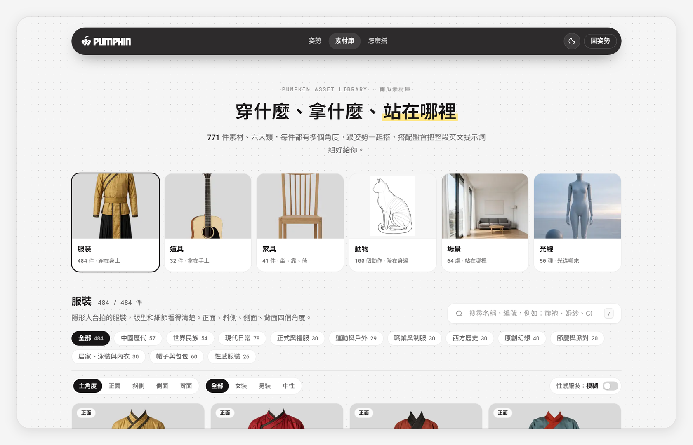</p>

| 庫 | 件數 | 角度 | 分類（件數） | 適合拿來 |
|---|---:|---|---|---|
| 👗 **服裝** | 484 | 正面、斜側、側面、背面 | 中國歷代 57、世界民族 54、現代日常 78、正式與禮服 30、運動與戶外 29、職業與制服 30、西方歷史 30、原創幻想 40、節慶與派對 20、居家泳裝與內衣 30、帽子與包包 60、性感服裝 26 | 換裝、角色設定、服裝考據 |
| 🎻 **道具** | 32 | 正面、背面、側面、斜側 | 樂器 10、古風與復古器物 10、手持與運動器材 12 | 手上拿著東西的姿勢 |
| 🪑 **家具** | 41 | 正面、背面、側面、斜側、俯視 | 坐臥家具 16、桌台 5、中式與世界風格 11、造型台與布景 9 | 坐、靠、倚的姿勢 |
| 🐈 **動物** | 100 | 正面、斜側、側面、俯視、仰視 | 貓 26、狗 31、小型寵物 7、馬與家畜 9、鳥 7、野生動物 11、幻想生物 9 | 人跟寵物同框、坐騎 |
| 🌆 **場景** | 64 | 平視、俯視、仰視 | 室內 14、城市戶外 12、自然與度假 17、古風與奇幻 15、攝影棚背景 6 | 背景、透視參考 |
| 💡 **光線** | 50 | 正面、斜側、側面 | 時段自然光 11、空間自然光 11、人造光源 11、攝影棚光位 10、氛圍與色彩 7 | 打光參考、氛圍定調 |

服裝用「隱形人台」拍：只看得到衣服本身的立體形狀，版型、領口、開衩都很清楚。動物跟姿勢同一種線稿畫法，夜間模式一樣會反白。不是每件都有齊全部角度，品質不夠的角度直接拿掉，卡片上灰掉的角度按鈕就是沒有。

### 找素材：分類、細分類、角度

1. 上方六張卡片切換素材庫。
2. 點分類膠囊，例如「中國歷代」，下面會再長出一排細分類：商、漢、魏晉、唐、宋、元、明、清、民國。
3. 服裝多一個「全部／女裝／男裝／中性」切換；性感服裝跟敏感姿勢一樣預設模糊，開關也共用。
4. 「主角度」是每件最有代表性的那一面；切到「背面」或「俯視」，整頁就一起換角度。

**預期結果**：選「服裝 → 中國歷代 → 明」再切「男裝」，會剩 6 件，網址也會變成 `library.html?lib=costume&cat=HC&sub=明&g=M`，可以直接分享。

<p align="center">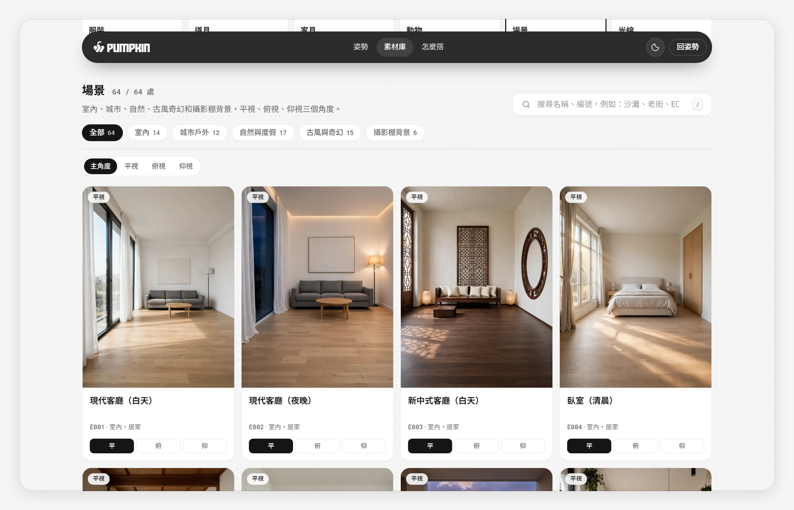</p>

### 看大圖：換角度、複製描述、加入搭配

點卡片打開大圖。右邊有全部角度的縮圖，下面是一段完整的英文描述，想單獨生成這件東西時可以直接拿去用。

| 按鈕／按鍵 | 作用 |
|---|---|
| **下載這張**（金色） | 下載目前角度的 900px 大圖 |
| **加入搭配**／<kbd>P</kbd> | 把這件放進搭配盤；再按一次就拿出來 |
| **打包這件** | 這件的所有角度打包成 ZIP |
| <kbd>←</kbd> <kbd>→</kbd> | 換上一件、下一件 |
| <kbd>↑</kbd> <kbd>↓</kbd> | 換角度 |
| 連結按鈕 | 複製這件的專屬網址，例如 `library.html#C052` |

<p align="center">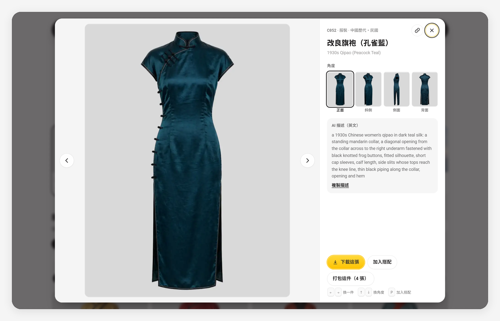</p>

### 搭配盤：一個姿勢＋六庫各一件

搭配盤就像購物車，只是裝的是姿勢和素材。七個格子：姿勢、服裝、道具、家具、動物、場景、光線，每格最多一件，需要的才挑。

<p align="center">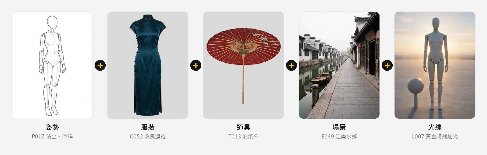</p>

**怎麼用：**

1. 在姿勢頁打開一套姿勢，按「加入搭配」。存進去的是你當下看的那個機位和格式。
2. 到素材庫，各庫挑想要的那一件，一樣按「加入搭配」。
3. 右下角會出現深色的「搭配盤」按鈕，點開就看到整組。

**預期結果**：面板下方的「合成英文提示詞」已經依「姿勢 → 服裝 → 道具 → 家具 → 動物 → 場景 → 光線」接好。按金色「複製提示詞」就能貼進生圖工具，按「打包這組圖」會把每一格的大圖打成一個 ZIP。

<p align="center">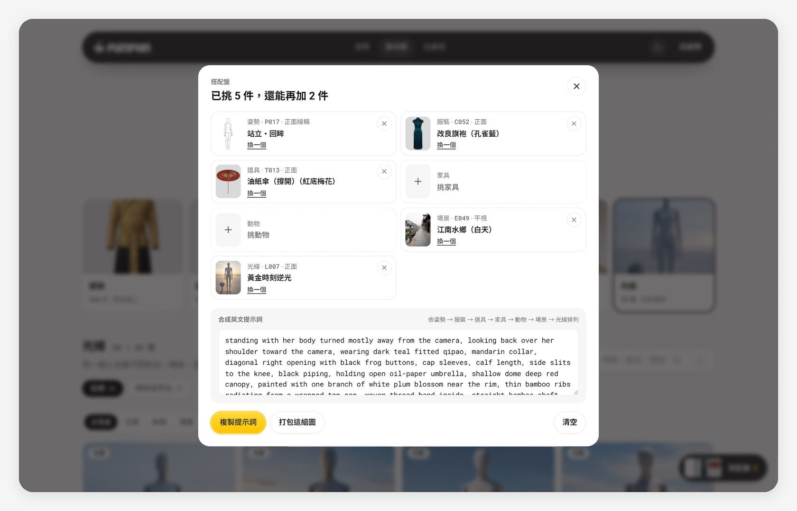</p>

每一格接進提示詞的樣子：

| 格子 | 接進去的樣子 |
|---|---|
| 姿勢 | 姿勢的英文描述原文 |
| 服裝 | `wearing …` |
| 道具 | `holding …` |
| 家具 | `on or next to …` |
| 動物 | `with a … nearby (…)` |
| 場景 | `setting: …` |
| 光線 | `lighting: …` |

<details>
<summary><b>上面那組搭配實際組出來的提示詞</b></summary>

實際上是一整段，這裡為了好讀，每一格換一行：

```text
standing with her body turned mostly away from the camera, looking back over her shoulder toward the camera,
wearing dark teal fitted qipao, mandarin collar, diagonal right opening with black frog buttons, cap sleeves, calf length, side slits to the knee, black piping,
holding open oil-paper umbrella, shallow dome deep red canopy, painted with one branch of white plum blossom near the rim, thin bamboo ribs radiating from a wrapped top cap, woven thread band inside, straight bamboo shaft and handle,
setting: canal along the left edge with stone embankment, whitewashed two-storey houses with black frames and grey tile roofs across the canal, horse-head gables, humpbacked stone bridge in the distance, shuttered shopfront with blank signboard and red lanterns on the right, granite flagstones, empty moored boat, empty centre flagstones,
lighting: low sun directly behind, golden rim on the outline, soft front shade, shadow toward the camera
```

</details>

> [!TIP]
> 用 Nano Banana、ChatGPT 這類能吃多張參考圖的工具時，把「姿勢線稿＋服裝圖」一起丟進去，再貼搭配盤的提示詞，衣服的版型會比只靠文字準很多。

搭配盤記在這台電腦的瀏覽器裡，換頁、關掉再開都還在；同一格再加別的會直接取代，按「清空」就整組重來。

<p align="center">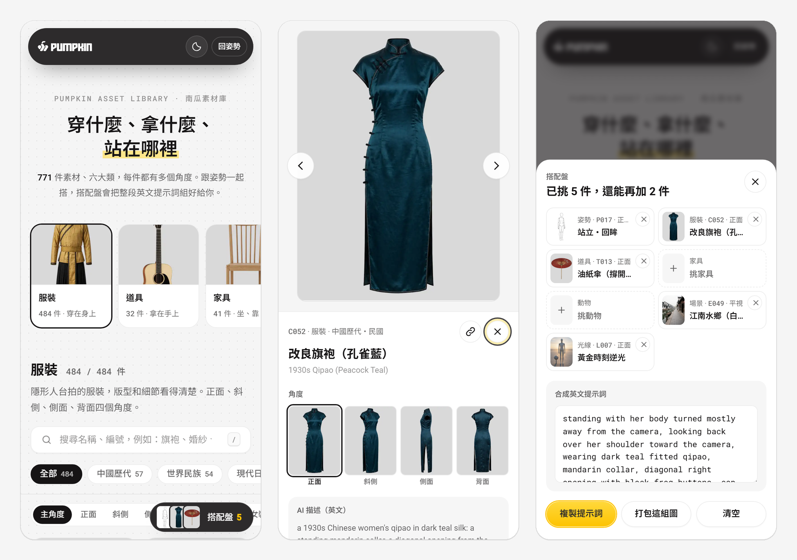</p>

<p align="center"></p>

## 🚀 快速開始

**最快的方式：直接打開線上版。** 不用安裝、不用登入。

👉 **https://nanhong-byte.github.io/pumpkin-poses/**

想在自己電腦上跑（例如內網、離線展示），三行指令：

```bash
git clone https://github.com/nanhong-byte/pumpkin-poses.git
```

```bash
cd pumpkin-poses
```

```bash
python -m http.server 8000
```

**預期結果**：終端機出現 `Serving HTTP on :: port 8000`，打開瀏覽器到 `http://localhost:8000` 就會看到首頁。

> [!IMPORTANT]
> 直接雙擊 `index.html` 也能瀏覽、看大圖，但**不能打包 ZIP**，因為瀏覽器不讓本機檔案互相讀取。要打包下載，請用上面的本機伺服器或線上版。

整個網站沒有後端、沒有建置步驟，就是一堆 HTML、CSS、JS 和圖片。要放到公司 NAS、內網或任何靜態空間，整個資料夾複製過去就能用。

## 📖 怎麼用

以下照實際操作順序走一遍。

### 1. 找姿勢：系列、分類、搜尋

首頁往下捲就是姿勢列表。最上面一排選**系列**，第二排選**分類**，右上角可以直接**搜尋**。

<p align="center">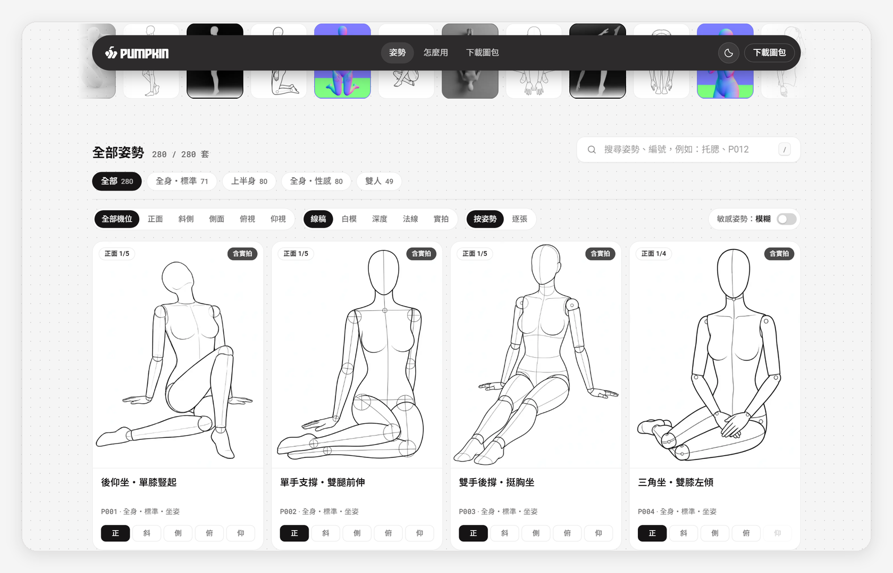</p>

- **搜尋**：中文名稱、編號、英文都吃，例如「托腮」「P012」「kneeling」。按鍵盤 <kbd>/</kbd> 可以直接跳到搜尋框。
- **機位**：選「側面」，所有卡片都換成側面圖，沒有側面的姿勢會先藏起來。
- **格式**：選「深度」，整個列表變深度圖，方便一眼挑。
- **按姿勢／逐張**：「按姿勢」一套一張卡；「逐張」把每個機位攤開，適合一次比較很多角度。
- **卡片上的「正 斜 側 俯 仰」**：點一下就換那張卡的機位，不用打開大圖。

一次先顯示 48 套，底下有「再顯示 48 套」按鈕。篩選條件會寫進網址，複製網址給同事，對方打開就是同一個畫面。

### 2. 看大圖：換機位、換格式

點任何一張卡片就會打開大圖。右邊是控制面板，左右箭頭換上一套／下一套。

<p align="center">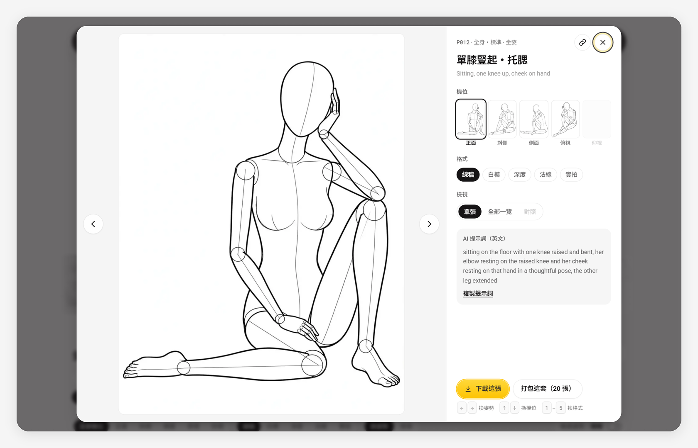</p>

| 按鍵 | 做什麼 |
|---|---|
| <kbd>←</kbd> <kbd>→</kbd> | 上一套、下一套姿勢 |
| <kbd>↑</kbd> <kbd>↓</kbd> | 換機位 |
| <kbd>1</kbd>–<kbd>5</kbd> | 線稿、白模、深度、法線、實拍風 |
| <kbd>Esc</kbd> | 關閉 |

手機上左右滑換姿勢、上下滑換機位。

### 3. 對照模式：線稿跟白模疊在一起看

在「檢視」選**對照**，左邊是線稿、右邊是目前格式，中間的金線可以拖。想確認線稿哪條線對應到身體哪個面，這個最好用。

<p align="center">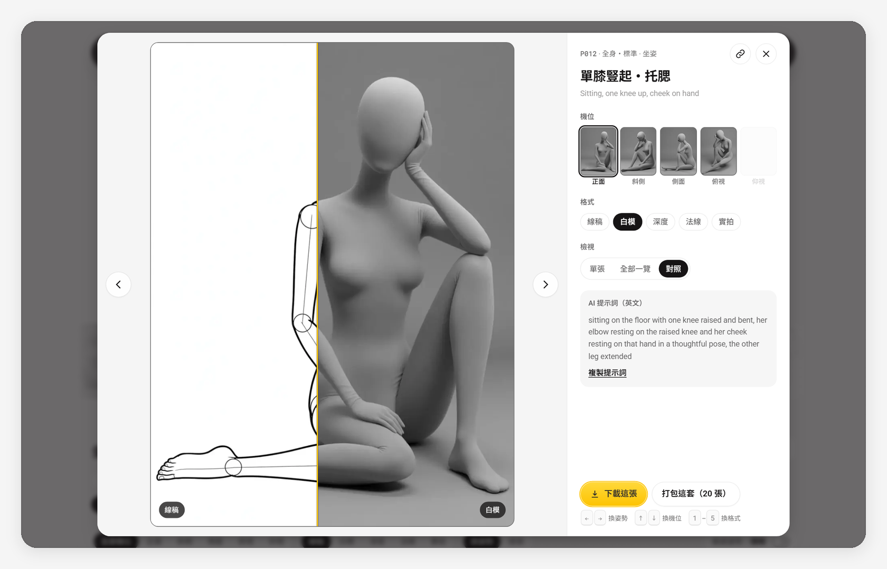</p>

對照模式支援白模、深度圖、法線圖，三者跟線稿是同一個構圖，疊起來剛好對齊。

### 4. 全部一覽：五機位 × 五格式一次看

選**全部一覽**，這套姿勢所有的圖排成一張表：橫的是機位、直的是格式。點任何一格就跳回單張。

<p align="center">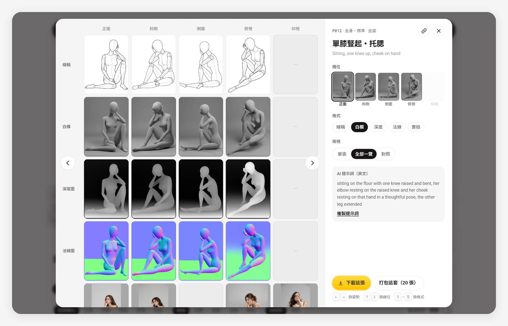</p>

### 5. 複製提示詞、下載、分享

大圖面板下方有三個動作：

1. **複製提示詞**：一段描述這個姿勢的英文，貼進 Stable Diffusion、Midjourney 很好用。
2. **下載這張**：下載目前這張寬 900px 的大圖，檔名會帶編號、機位、格式，例如 `pumpkin-pose_P012_front_clay.webp`。
3. **打包這套**：把這套姿勢的所有機位、所有格式打包成一個 ZIP。

右上角的🔗按鈕會複製這套姿勢的專屬連結（網址結尾是 `#P012`），對方點開直接看到這套。

### 6. 打包下載整個系列

要一次拿很多張，捲到最下面的「下載圖包」。勾系列、勾格式，下面會即時算出張數和大小。

<p align="center">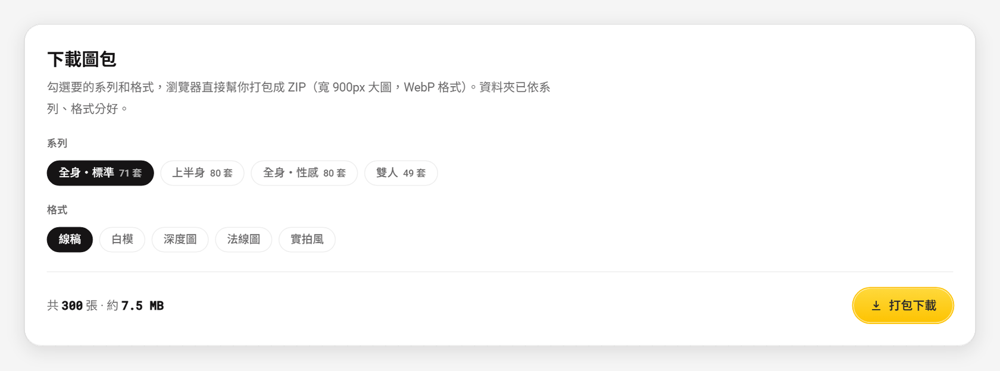</p>

按「打包下載」後，瀏覽器會把圖抓下來壓成 ZIP，進度條會顯示到第幾張。ZIP 裡的資料夾長這樣：

```text
pumpkin-poses_std_line.zip
└─ 全身・標準/
   └─ 線稿/
      ├─ P001_後仰坐・單膝豎起_正面.webp
      ├─ P001_後仰坐・單膝豎起_斜側.webp
      └─ …
```

<details>
<summary><b>各系列、各格式的大小參考（寬 900px 大圖）</b></summary>

| 系列 | 線稿 | 白模 | 深度圖 | 法線圖 | 實拍風 |
|---|---|---|---|---|---|
| 全身・標準 | 300 張・7.5 MB | 261 張・2.3 MB | 261 張・1.8 MB | 261 張・4.0 MB | 89 張・2.1 MB |
| 上半身 | 359 張・10 MB | 256 張・2.5 MB | 256 張・2.0 MB | 256 張・4.5 MB | — |
| 全身・性感 | 352 張・9.4 MB | 291 張・2.8 MB | 291 張・2.1 MB | 291 張・4.9 MB | — |
| 雙人 | 201 張・7.8 MB | 136 張・1.6 MB | 136 張・1.2 MB | 136 張・2.9 MB | — |

全部系列、全部格式加起來約 70 MB。本機實測打包「全身・標準＋線稿」300 張約 16 秒。

</details>

### 7. 夜間模式、手機版、敏感姿勢

右上角的月亮切換夜間模式，選擇會記在瀏覽器裡。夜間時線稿自動反白，看久了不刺眼；**下載的檔案不受影響，還是白底黑線**。

<p align="center">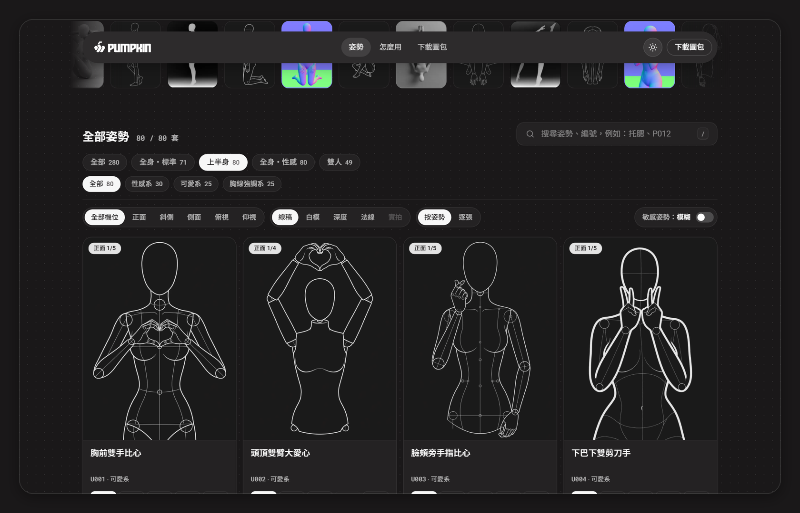</p>

手機版把篩選列改成左右滑，大圖上下分成圖片和面板：

<p align="center">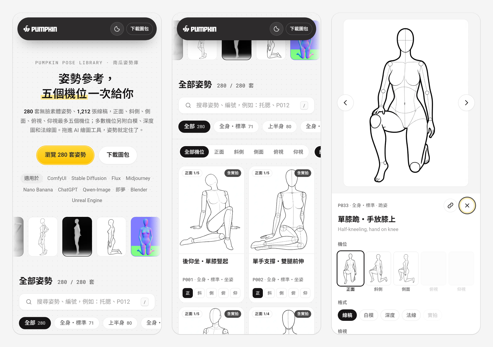</p>

全身・性感、雙人，以及上半身的部分姿勢預設會模糊。點一下卡片只顯示那一張；想全部顯示，打開列表上方的「敏感姿勢」開關。

<p align="center">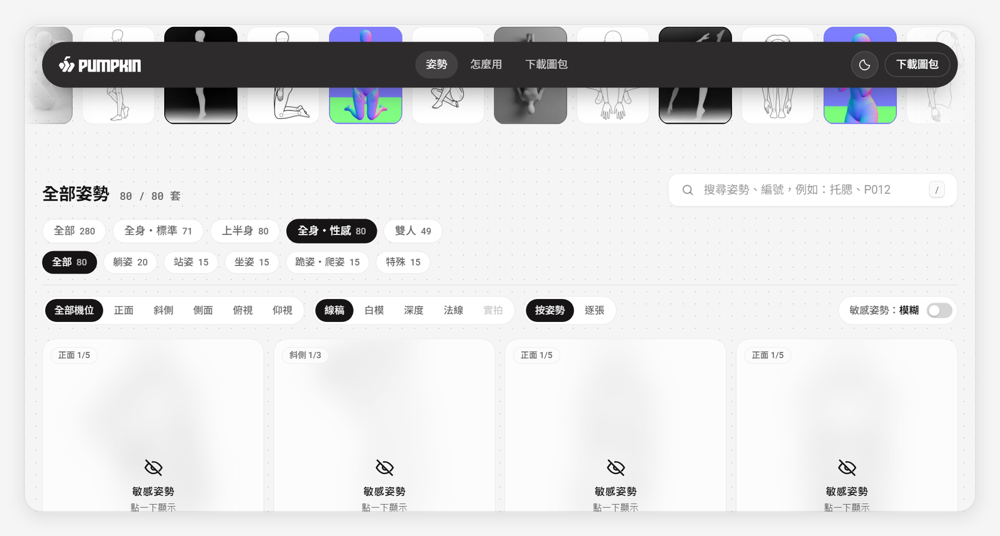</p>

<p align="center"></p>

## 🤖 搭配 AI 工具

每個工具「看懂姿勢」的方式不同。下表是我們實際用的配法，標籤意思是：🟢 拿了就能用／🟡 能用但姿勢不一定完全照做。

| 工具 | 推薦格式 | 怎麼用 | 貼合度 |
|---|---|---|---|
| **ComfyUI／Stable Diffusion** | 線稿、深度圖、法線圖 | 接 ControlNet：線稿配 Lineart 或 Canny、深度圖配 Depth、法線圖配 Normal | 🟢 |
| **Flux** | 線稿、深度圖 | 在 ComfyUI 裡用 Flux 的 ControlNet（Canny／Depth） | 🟢 |
| **Nano Banana** | 線稿、白模 | 上傳圖片當參考，提示詞寫「照這張圖的姿勢」 | 🟢 |
| **ChatGPT** | 線稿、白模 | 同上，上傳後用中文描述想要的人物和場景 | 🟢 |
| **Qwen-Image／即夢** | 線稿、白模 | 上傳參考圖；姿勢貼合度看工具版本 | 🟡 |
| **Midjourney** | 白模、實拍風 | 當圖片參考，搭配英文提示詞 | 🟡 |
| **Blender／Unreal Engine** | 五機位線稿 | 放進場景當參考平面，對著擺骨架 | 🟢 |

用 Nano Banana 或 ChatGPT 時，提示詞可以這樣寫：

```text
只參考這張圖的人物姿勢，不要參考線條畫風。
畫一位穿白色連身裙的女生，坐在海邊的木棧道上，傍晚逆光，電影感，寫實攝影。
```

用 Stable Diffusion 時，把大圖裡的英文提示詞複製過來，前面加上風格、後面加上場景：

```text
masterpiece, cinematic photo, sitting on the floor with one knee raised and bent, her elbow resting on the raised knee and her cheek resting on that hand in a thoughtful pose, the other leg extended, wooden deck by the sea, golden hour
```

> [!NOTE]
> ControlNet 的強度（weight）建議從 0.6–0.8 開始試。太高會連線稿的關節圓圈都畫出來，太低姿勢又會跑掉。

## 🧩 網站怎麼組成

整個網站是純前端，像一本放在網路上的型錄：沒有資料庫、沒有伺服器程式，打開就是讀檔案。

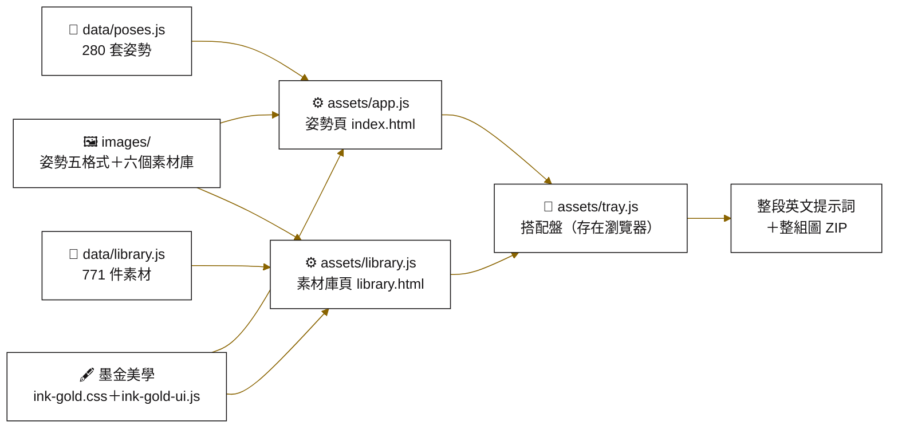

```text
pumpkin-poses/
├─ index.html              ← 姿勢頁
├─ library.html            ← 素材庫頁
├─ assets/
│  ├─ ink-gold.css         ← 墨金美學設計套件（紙、墨、金、元件）
│  ├─ ink-gold-ui.js       ← 會向游標聚攏的點陣背景＋日夜切換
│  ├─ app.css              ← 兩頁共用的樣式（卡片、大圖、下載區、搭配盤）
│  ├─ app.js               ← 姿勢頁主程式
│  ├─ library.js           ← 素材庫頁主程式
│  ├─ tray.js              ← 搭配盤＋兩頁共用的小工具
│  └─ brand/               ← 南瓜 Logo
├─ data/
│  ├─ poses.js             ← 姿勢資料（名稱、分類、提示詞、檔名）
│  ├─ library.js           ← 素材資料（771 件）
│  └─ libs-meta.js         ← 六個庫的名稱、件數、封面（首頁入口用）
├─ images/
│  ├─ line/   clay/   depth/   normal/   photo/                ← 姿勢
│  ├─ costume/   prop/   furniture/   animal/   scene/   light/ ← 素材庫
│  │  └─ w300/  w600/  w900/
└─ docs/                   ← 這篇 README 用的圖
```

介面用的是南瓜自己的設計語言「墨金美學」：淡紙承載內容、墨字建立順序、金色只標下一步。所以只有「瀏覽姿勢」「下載這張」「打包下載」「複製提示詞」這幾顆主按鈕是金色的。

<details>
<summary><b>一筆姿勢資料長什麼樣</b></summary>

```json
{
  "id": "P012",
  "s": "std",
  "c": "坐姿",
  "n": "單膝豎起・托腮",
  "en": "Sitting, one knee up, cheek on hand",
  "d": "sitting on the floor with one knee raised and bent, ...",
  "x": 0,
  "l": ["std_P012_front.webp", "std_P012_diag.webp", "std_P012_side.webp", "std_P012_above.webp", null],
  "m": ["std_P012_front.webp", "std_P012_diag.webp", "std_P012_side.webp", "std_P012_above.webp", null],
  "p": ["std_P012_front.webp", null, null, null, null]
}
```

| 欄位 | 意思 |
|---|---|
| `id` | 編號，P＝標準、U＝上半身、S＝性感、D＝雙人 |
| `s` | 系列：`std`／`upper`／`sexy`／`duo` |
| `c`、`n` | 分類、中文名稱 |
| `en`、`d` | 英文名稱、英文提示詞 |
| `x` | 1＝敏感姿勢，預設模糊 |
| `l` | 線稿檔名，依序是正面、斜側、側面、俯視、仰視；`null` 代表沒有這個機位 |
| `m` | 白模、深度圖、法線圖共用的檔名（各自放在自己的資料夾） |
| `p` | 實拍風檔名 |

</details>

<details>
<summary><b>一筆素材資料長什麼樣</b></summary>

```json
{
  "id": "C052",
  "l": "costume",
  "c": "HC",
  "s": "民國",
  "n": "改良旗袍（孔雀藍）",
  "en": "1930s Qipao (Peacock Teal)",
  "d": "a 1930s Chinese women's qipao in dark teal silk: a standing mandarin collar, ...",
  "k": "dark teal fitted qipao, mandarin collar, diagonal right opening, ...",
  "f": ["costume_C052_front.webp", "costume_C052_diag.webp", "costume_C052_side.webp", "costume_C052_back.webp"],
  "m": 0,
  "g": "F"
}
```

| 欄位 | 意思 |
|---|---|
| `id` | 編號，C＝服裝、T＝道具、F＝家具、A＝動物、E＝場景、L＝光線 |
| `l`、`c`、`s` | 屬於哪個庫、分類代碼、細分類 |
| `n`、`en` | 中文名稱、英文名稱 |
| `d` | 完整英文描述（大圖裡「複製描述」用） |
| `k` | 精簡英文描述（搭配盤接提示詞用） |
| `f` | 各角度檔名，順序跟該庫的角度清單一樣；`null` 代表沒有這個角度 |
| `m` | 主角度是第幾個 |
| `x` | 1＝性感服裝，預設模糊 |
| `g` | 服裝才有：`F` 女裝、`M` 男裝、`U` 中性 |
| `sp` | 動物才有：英文物種名，搭配盤用 |

</details>

<details>
<summary><b>網址參數：做連結時可以直接帶</b></summary>

**姿勢頁（index.html）**

| 參數 | 例子 | 效果 |
|---|---|---|
| `series` | `?series=std` | 只看某個系列（`std`／`upper`／`sexy`／`duo`） |
| `cat` | `?series=std&cat=坐姿` | 只看某個分類 |
| `angle` | `?angle=2` | 只看某個機位（0 正面 ～ 4 仰視） |
| `fmt` | `?fmt=depth` | 列表改成某種格式（`line`／`clay`／`depth`／`normal`／`photo`） |
| `view` | `?view=single` | 逐張模式 |
| `q` | `?q=托腮` | 帶搜尋字 |
| `theme` | `?theme=night` | 夜間模式 |
| `#編號` | `#P012` | 直接打開那套姿勢的大圖 |

**素材庫頁（library.html）**

| 參數 | 例子 | 效果 |
|---|---|---|
| `lib` | `?lib=scene` | 打開某個庫（`costume`／`prop`／`furniture`／`animal`／`scene`／`light`） |
| `cat` | `?lib=costume&cat=HC` | 只看某個分類（用分類代碼） |
| `sub` | `&sub=明` | 只看某個細分類 |
| `g` | `&g=F` | 服裝性別（`F`／`M`／`U`） |
| `view` | `&view=back` | 整頁換成某個角度 |
| `q` | `&q=旗袍` | 帶搜尋字 |
| `#編號-角度` | `#C052-side` | 直接打開那件素材的某個角度 |

</details>

## 📝 名詞對照表

| 名詞 | 白話 | 在這裡的角色 |
|---|---|---|
| **ControlNet** | 給 AI 生圖加一個「骨架」，叫它照著畫 | 線稿、深度圖、法線圖都是餵給它的 |
| **線稿** | 只有線條的人偶草圖 | 最通用的姿勢參考 |
| **白模** | 沒上色、沒貼圖的灰色 3D 模型 | 看體積和明暗 |
| **深度圖** | 用黑白表示遠近，越白越近 | 讓 AI 抓前後層次 |
| **法線圖** | 用顏色表示表面朝哪個方向 | 讓 AI 抓身體轉向與面的轉折 |
| **img2img** | 拿一張圖當底，叫 AI 在上面重畫 | 白模最常這樣用 |
| **機位** | 鏡頭擺在哪、從哪個角度拍 | 正面、斜側、側面、俯視、仰視 |
| **WebP** | 比 PNG 小很多的圖片格式 | 本站所有圖的格式 |
| **隱形人台** | 衣服穿在假人身上拍，再把假人修掉，只留下衣服的立體形狀 | 服裝庫的拍法 |
| **搭配盤** | 本站的「購物車」，只是裝的是姿勢和素材 | 一鍵組出整段提示詞 |
| **localStorage** | 瀏覽器幫網站在你電腦裡記的小筆記 | 搭配盤、日夜模式、模糊開關都記在這 |

## ❓ 常見問題

<details>
<summary><b>圖片可以拿去商用嗎？</b></summary>

可以，個人和商業創作都能免費使用。圖中人物都是無臉素體或 AI 生成的成年人，不涉及真實人物。
</details>

<details>
<summary><b>為什麼有些機位是灰的、點不了？</b></summary>

那個角度的圖品質不夠好（例如手腳穿插、比例跑掉），我們直接不放。卡片左上角的「正面 1/4」就代表這套有 4 個機位。白模、深度圖、法線圖也一樣，某些機位只有線稿。
</details>

<details>
<summary><b>直接點開 index.html，為什麼打包下載沒反應？</b></summary>

瀏覽器的安全規定不讓「本機檔案」去讀其他本機檔案，所以打包功能要用網址開啟。照 [快速開始](#-快速開始) 跑 `python -m http.server`，或直接用線上版就好。瀏覽、看大圖、下載單張都不受影響。
</details>

<details>
<summary><b>夜間模式下線稿是白線，下載下來也會是白線嗎？</b></summary>

不會。反白只是畫面上的顯示效果，下載的檔案永遠是原本的白底黑線。
</details>

<details>
<summary><b>敏感姿勢的開關會記住嗎？</b></summary>

會記在這台電腦的瀏覽器裡，下次打開還是同一個設定。一張一張點開的只算這次瀏覽，重新整理後會再模糊回去。
</details>

<details>
<summary><b>搭配盤會不會不見？</b></summary>

搭配盤記在這台電腦的這個瀏覽器裡：換頁、關掉分頁、隔天再開都還在。換一台電腦、換瀏覽器，或用無痕視窗，就看不到原本那組。想留著的組合，先按「複製提示詞」貼到筆記裡最保險。
</details>

<details>
<summary><b>AI 工具不吃 WebP 怎麼辦？</b></summary>

主流工具（ComfyUI、Nano Banana、ChatGPT、Midjourney）都直接吃 WebP。真的遇到不吃的，用 Windows 的「小畫家」打開再另存成 PNG 就好。
</details>

<details>
<summary><b>想加自己的姿勢，要改哪裡？</b></summary>

1. 把圖片轉成 WebP，做成 300、600、900 三種寬度（線稿和白模類用 3:4 直式），分別放進 `images/<格式>/w300`、`w600`、`w900`。
2. 在 `data/poses.js` 的 `poses` 陣列加一筆，格式照上面「一筆姿勢資料長什麼樣」。
3. 如果是新分類，在同檔案的 `series` 裡把分類名稱和數量也補上。
4. 改 `index.html` 裡的 `?v=1.1.0` 版本號，讓瀏覽器重新抓檔案。

**預期結果**：重新整理後，新姿勢出現在列表最後面，搜尋得到。
</details>

## 🧭 接下來

- [x] 280 套姿勢 × 五機位 × 五格式
- [x] 全站台灣繁體中文、墨金美學介面、夜間模式、手機版
- [x] 瀏覽器直接打包 ZIP、單套打包、專屬分享連結
- [x] 線稿與白模、深度圖、法線圖左右對照
- [x] 素材庫：服裝、道具、家具、動物、場景、光線，共 771 件
- [x] 搭配盤：一個姿勢＋六庫各一件，自動組出整段英文提示詞
- [ ] 中文版 AI 提示詞
- [ ] 下載時可選 PNG
- [ ] 搭配盤存成多組，整組可以分享連結

有想要的姿勢或功能，歡迎開 Issue 告訴我們。

<p align="center"></p>

— 南瓜｜南瓜虛擬科技 · XR／3D／AI 工作流

<sub>由 南瓜虛擬科技 製作 · 最後更新 2026-11-17</sub>
